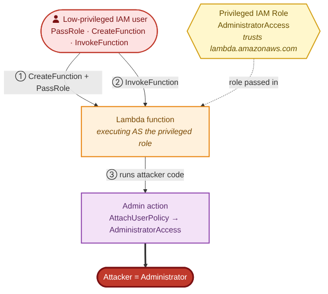

# AWS IAM Privesc

> A hands-on cloud security lab that builds a vulnerable AWS IAM configuration,
> exploits it to escalate from a low-privileged user to administrator and
> detects the attack in CloudTrail logs.

## Overview
This lab walks through a complete offensive-and-defensive workflow around a
common AWS IAM misconfiguration in three stages:

- **Build** — Terraform provisions a deliberately vulnerable IAM setup.
- **Attack** — using PMapper and Pacu, a low-privileged user escalates to
  administrator via the `iam:PassRole` + Lambda path.
- **Detect** — the Attack's footprint in CloudTrail is analyzed and a detection
  rule is written for it.

The goal is to show not just how the attack works but how to catch it.

## Attack Path
The escalation abuses the `iam:PassRole` permission:

1. A low-privileged IAM user holds `iam:PassRole`, `lambda:CreateFunction`,
   and `lambda:InvokeFunction`.
2. A privileged IAM role exists whose trust policy allows the Lambda service to
   assume it.
3. The user creates a Lambda function and passes the privileged role to it.
4. The function runs attacker-supplied code with that role's permissions.
5. Invoking it performs administrative actions (e.g. attaching
   `AdministratorAccess`), completing the escalation.

   

## Prerequisites
- An AWS account (sandbox / non-production)
- Terraform and the AWS CLI
- Pacu and PMapper

## Setup
_Coming — Terraform to stand up the vulnerable environment._

## Exploitation
_Coming — walking the privilege-escalation path with PMapper and Pacu._

## Detection
_Coming — the CloudTrail events the attack generates and the detection logic._

## Cleanup
Run `terraform destroy` to remove all lab resources. The vulnerable
configuration is not meant to outlive the exercise.

## Disclaimer
This project is for educational purposes and authorized testing only, in an
AWS account you own and control.